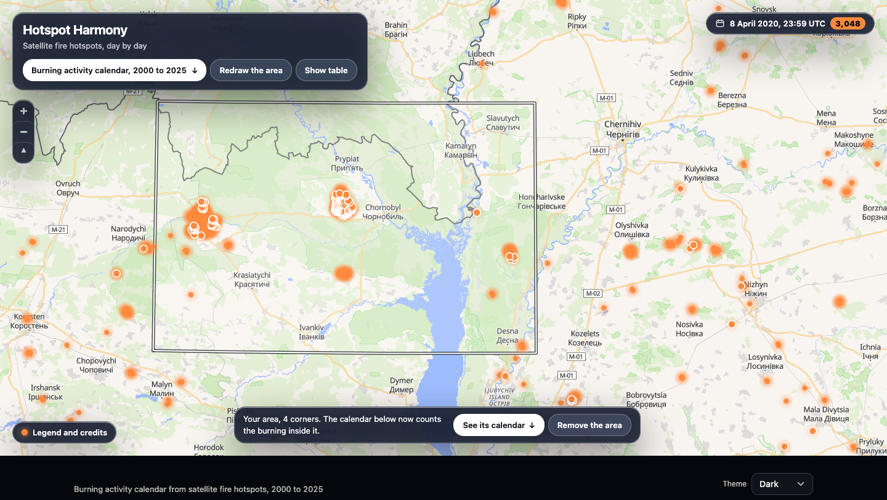
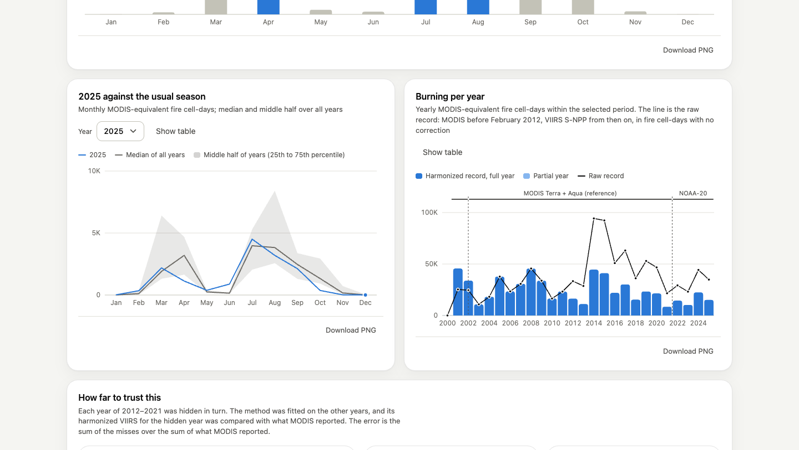

# hotspot-harmony

One comparable record of satellite fire hotspots from 2000 to today, built from two generations of
sensors (MODIS and VIIRS), and a burning activity calendar for any area you draw on a map.

Built during the 2026 NASA Space Apps Challenge for the challenge
[Harmonization of MODIS and VIIRS Hot Spots](https://www.spaceappschallenge.org/2026/challenges/modis-and-viirs-hot-spots/).

**Demo:** not deployed yet.



*One click on "Chornobyl exclusion zone, April 2020": the hotspots of 8 April 2020 on the globe, the area drawn around the zone, and below it the burning activity calendar of that area since 2000.*



*Ukraine per year. The line is the raw record: it doubles from 2012, when VIIRS replaces MODIS. The columns, harmonized, do not. The strip on top says where each year comes from: MODIS as reported up to 2021, VIIRS NOAA-20 harmonized to MODIS from 2022.*

## Why

Satellites have recorded active fires since 2000, but the record is split between sensors that
cannot be compared directly: MODIS (1 km pixels, in orbit since 2000, near the end of its life) and
VIIRS (375 m pixels, since 2012). VIIRS reports several times more hotspots for the same fires. Put
the two side by side and a fake jump appears in every trend. This project removes that jump so that
a fire manager can ask "is this month unusual for my area?" and get an answer that does not depend
on which satellite was flying.

## Status

| Part | State |
|---|---|
| Ingest FIRMS country archives (2000-2025) | done |
| Normalize MODIS and VIIRS to one point schema | done |
| Aggregate to grid cell x month x sensor | done |
| Fire cell-days on a 1 km grid, local solar day | done |
| Harmonize the sensors and validate on held-out years | done, see [docs/METHOD.md](docs/METHOD.md) and [docs/VALIDATION.md](docs/VALIDATION.md) (generated) |
| API (FastAPI): calendar, anomaly, CSV export, daily hotspots, validation | done; serves the raw and the harmonized series in fire cell-days, daily hotspot counts and coordinates with the days a sensor was down, and the held-out error with its two baselines from `harmonization_report.json` |
| Web app: 3D satellite globe, date and time picker, filters, calendar, charts, downloads | done; a region or any country can be found by the search in the filters, or a box typed in degrees; the calendar opens on the log scale; downloads: calendar data as CSV, every chart as PNG |
| Area of interest drawn on the globe | done; "Draw an area" places the corners of a polygon by click, and the calendar, the charts and both CSV downloads then count what is inside its outline; the area travels in the link (`&area=lon,lat;...`). Only inside the regions that have data |
| Country picked on the globe | done for the countries with data (Argentina, Ukraine); a double-click or a double tap on a country outlines its border, and the calendar, the charts and the downloads then count what is inside it; the country travels in the link (`&country=Name`). Any other country of the world can be picked too and shows a "No record yet" card until its data are loaded: one entry in `config/regions.yaml`, then `make data` |
| Headline: the season's peak against its history | done; the busiest of the last 12 months of the period, against the same month in every year of the record |
| Unusual months and the area in words | done; a card lists the months that stand out from the same month of the other years (robust z of 3.5 or more and beyond the method's error), largest first, each showing its year on the calendar; "In short" gives the peak months, the busiest year, the change between the halves of the period and what stands out, figure first, each line a link to its card, from those figures only (the season's verdict is left to the headline above it) |
| Peak burning months (critical periods) | done; a card under the calendar names the fewest months that hold 60% of a typical year of the area, with each month's share, a table view and arrow-key reading |
| The sensor jump on the yearly chart | done; the raw record is a line over the harmonized columns, and a strip names the sensor behind each year |
| Sensor gap days on the globe | done; days a sensor was down are hatched in the date panel and called missing data, not a quiet day |
| Where it burns on the globe | done; a switch colours 0.25-degree cells by fire cell-days a year per 100 km² over the chosen period, or 1-degree tiles by how burning changed between the halves of the period (either size can be chosen for either view); a tile says how many years it burned in and in which month most, and a click makes it the area of interest. On the raw record the change map shows the rise the 2012 sensor switch fakes |
| Where in the area it burns most | done; a card lists the five busiest grid cells of the chosen area with their month, and "Show on the map" flies there |
| Globe or flat map | done; a switch on the map lays the same world flat (Web Mercator) with every layer, the drawn area and the tiles kept; the choice travels in the link (`&view=flat`) |
| Example areas | done; links in the filters card open the Chornobyl exclusion zone in April 2020 and the southern steppe in summer 2015, each as a drawn area with its busiest day on the globe |
| "How far to trust this" in the web app | done; under the charts, for the chosen country: the held-out error per month (per 1-degree tile when the area is smaller than the country), the two baselines, and the run that wrote the figures |
| Hotspots of every country for the globe's day view | file built, not served yet; `make day-points` reads the 48 FIRMS global zips (9.4 GB) one at a time into `data/day_points/`: 277 million hotspots of 234 countries, 2000-11 to 2025-12, in 1.14 GB (MODIS before 2012-02, VIIRS S-NPP after, filters applied). For Ukraine and Argentina it holds exactly the hotspots of `data/points/`. On 1,459 of its 9,131 days it holds more than the API's day limit of 50,000 (the busiest, 2023-09-23, 148,702). The API's day view does not read it yet |
| Public demo | not deployed yet |

## How far to trust it

Every year of 2012-2021, the years the method is fitted on, was left out in turn: the method was fitted on
the other years, and its harmonized VIIRS for the left-out year was compared with what MODIS reported.
The error is the sum of the misses over the sum of what MODIS reported (WAPE). From
[docs/VALIDATION.md](docs/VALIDATION.md), written by `make validate NESTED=1` on 2026-11-14 21:50 UTC,
where the method itself was also chosen again for every left-out year:

| | Ukraine | Argentina |
|---|---|---|
| Country, per year | 2.7% | 4.8% |
| Country, per month | 5.8% | 6.6% |
| 1-degree tile, per month | 18.9% | 22.8% |
| Sensor jump, mean yearly total 2012-2016 over 2007-2011: raw record | 2.00x | 1.32x |
| The same, harmonized record | 0.90x | 0.66x |

Up to 2021 the harmonized record is MODIS as reported, so the 0.66x in Argentina is what MODIS itself
saw in 2012-2016, not something the harmonization did. Where the method loses: per year in Argentina
one scaling factor for the whole country does better (3.5%), and that factor was fitted on all years,
the scored one included. The method, the options that were tried and left out, and why, are in
[docs/METHOD.md](docs/METHOD.md) and [ADR 0001](docs/adr/0001-harmonize-to-modis-equivalent-fire-cell-days.md).

## Limitations

- A hotspot is a fire the satellite detected. Clouds, smoke and the time of the overpass hide some fires, so no
  hotspot does not prove there was no fire. The record counts detected burning.
- The record ends in December 2025, the last year in the FIRMS country archive: there is no current month yet.
- The method's error was measured per country and per 1-degree tile. Smaller areas, such as a 0.25-degree cell, are
  finer than that, and the app says so where it shows them.
- From 2022 the record of Ukraine also holds the fires of the war in the east and south.

## Run it

Requires [uv](https://docs.astral.sh/uv/) and `make`.

```bash
make data                  # download, normalize, aggregate, harmonize, validate every country in config/regions.yaml
make data COUNTRY=Ukraine  # one country only
make day-points            # hotspots of every country for the globe's day view (about 10 GB of zips, kept zipped)
make api                   # serve the API on http://localhost:8000 (endpoints listed at /docs)
make web                   # serve the web app on http://localhost:5173 (needs `make api` running, and Node 24)
make test                  # pytest and the web tests (run `npm install` in web/ once)
make lint                  # ruff + English-only check
make borders               # rebuild web/public/countries.geojson from Natural Earth (only when the borders change)
```

`make data` needs no account or key. It downloads public yearly CSV files from FIRMS
(roughly 200 MB for Ukraine) and skips files that are already there.

To add a country, add one entry to [`config/regions.yaml`](config/regions.yaml) and run `make data`.

To process the whole world, use [`config/world.yaml`](config/world.yaml):

```bash
make data CONFIG=config/world.yaml   # every country, from one FIRMS zip per sensor and year
make api CONFIG=config/world.yaml    # serve it; the region list then holds a single "World" entry
```

This downloads about 10 GB of zips and extracts about 50 GB of CSV files into `data/raw/`.

## Layout

```
config/regions.yaml   countries, grid size, filters
pipeline/             ingest -> normalize -> aggregate -> harmonize -> validate (+ tests)
api/                  FastAPI service over the pipeline's output (+ tests)
web/                  React + TypeScript dashboard (Vite); charts are hand-written SVG, no chart library
docs/                 METHOD.md, ADRs, and VALIDATION.md + the sensor jump figure (both generated)
research/             experiments that are not part of the pipeline
data/                 generated, git-ignored (see data/README.md)
CLAUDE.md             instructions for AI coding agents
GLOSSARY.md           the project's vocabulary
.claude/skills/       agent skills (see "Working with AI agents")
```

## Working with AI agents

The repo is set up so that a coding agent can start work without a briefing:

- [`CLAUDE.md`](CLAUDE.md) holds the rules, the data facts that are easy to get wrong, and the open decisions.
- [`GLOSSARY.md`](GLOSSARY.md) fixes one word per concept, for people and agents alike.
- [`.claude/skills/`](.claude/skills/) holds eleven skills from
  [mattpocock/skills](https://github.com/mattpocock/skills) (MIT, see `.claude/skills/NOTICE.md`).

| Skill | Use |
|---|---|
| `tdd`, `codebase-design` | build pipeline logic test-first |
| `diagnosing-bugs` | find the cause of a wrong number or a failing step |
| `research` | check a fact against primary sources and save a cited note |
| `prototype` | answer a design question with throwaway code |
| `domain-modeling`, `grilling` | sharpen terms and decisions, keep `GLOSSARY.md` and ADRs current |
| `pr` | write a PR body that is fast to review |
| `writing-for-agents` | edit `CLAUDE.md` or a skill |
| `/grill-with-docs` | you type it: get interviewed about a design before building it |
| `/handoff` | you type it: pack the session into a note for the next person or agent |

The agent picks up every skill except the last two on its own. Update the copies with
`npx skills update`; `skills-lock.json` records where each one came from.

## Data and credits

The fire data come from NASA FIRMS (MODIS Collection 6.1, VIIRS 375 m):
<https://firms.modaps.eosdis.nasa.gov/>

- MODIS on Terra and Aqua, from November 2000
- VIIRS on Suomi NPP, January 2012 to November 2026
- VIIRS on NOAA-20, from April 2018

The record ends in December 2025, the last year in the FIRMS country archive. 2026 is out of scope.

By default the pipeline keeps presumed vegetation fires (FIRMS `type = 0`) and drops
low-confidence detections. Both filters are set in `config/regions.yaml`.

The globe in the web app shows:

- Imagery: NASA GIBS (Blue Marble). We acknowledge the use of imagery provided by services from
  NASA's Global Imagery Browse Services (GIBS), part of NASA's Earth Science Data and Information
  System (ESDIS).
- Borders, place labels and the street map: [OpenFreeMap](https://openfreemap.org/),
  [OpenMapTiles](https://openmaptiles.org/), data © [OpenStreetMap](https://www.openstreetmap.org/copyright) contributors.
- Borders a country is picked and counted by: [Natural Earth](https://www.naturalearthdata.com/) 1:10m
  Admin 0 - Countries (public domain), simplified to about 2 km by `make borders` into
  `web/public/countries.geojson`.

The same credits are in the globe's legend.

## Contributing

- **English only.** Code, comments, docs, UI text, commit messages, branch names, PR titles and
  bodies, issues and review comments are written in English, whoever or whatever writes them.
  CI fails when Cyrillic text shows up in a tracked file, a commit message, or a PR title or body.
  The one exception is `web/src/uk.ts`: the page opens in English and can be switched to Ukrainian,
  and those texts live there, keyed by the English ones.
- Work on a branch and open a pull request against `main`.
- Run `make test` and `make lint` before you push.
- **No commits after Sunday 2026-11-15 23:59 Kyiv time (21:59 UTC).** The hackathon submission is frozen then.

## Use of AI tools

- **Writing the code, tests and docs.** An AI coding assistant (Claude Code by Anthropic) was used to write
  the code, tests and documentation in this repository: the data pipeline, the API and the web app,
  under the team's direction and review. The rules it works by are in [`CLAUDE.md`](CLAUDE.md).
- **Code review.** Pull requests were also reviewed with the same assistant, and its findings were
  fixed in follow-up pull requests.
- **Competitor scan.** The assistant read the public repositories of other entries to this challenge
  (their README files and code) and summarised their methods, validation and demos, so that we could
  see where this project stands. Ideas only: no code was copied.
- **Inside the product, no language model runs.** The harmonization fits its own small models to the
  FIRMS data (a table by fire power, and gradient boosting from scikit-learn where it beats the table on
  held-out years); anomalies and peak burning months are plain statistics.

## License

MIT, see [LICENSE](LICENSE). This project is not affiliated with or endorsed by NASA.
