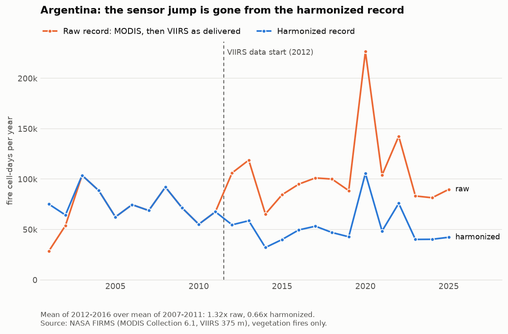

# Method

How MODIS and VIIRS hotspots become one record. The numbers that back this up are generated, not
typed: see [VALIDATION.md](VALIDATION.md) and `data/agg/harmonization_report.json`.

## The problem in one picture

MODIS (1 km pixels, since 2000) and VIIRS (375 m pixels, since 2012) look at the same fires and
report different amounts of them. VIIRS sees small fires that MODIS misses, and puts several
detections on a fire that MODIS reports once. Splice the two archives and every area shows a jump
in 2012 that never happened on the ground.

## Unit

**MODIS-equivalent fire cell-days.** One fire cell-day is one ~1 km cell with at least one
detection on one local solar day. The record answers "what would Terra + Aqua MODIS have reported",
because that is the direction that needs no invention: a finer sensor can be made to imitate a
coarser one, but a coarse sensor cannot recover fires it never saw.

## Steps

1. **Keep vegetation fires.** FIRMS `type = 0`; low-confidence detections dropped. Static sources
   (industry, flares), volcanoes and offshore detections stay in the point store but out of the record.
2. **Local solar day.** Overpass time is shifted by longitude, so a night overpass just before
   00 UTC lands on the same day as the afternoon overpass of the same fire.
3. **Fire cell-days on a ~1 km equal-area grid.** Counting burning cells instead of detections
   removes the pixel-size effect: VIIRS averages about 1.6 detections per cell-day, MODIS about 1.1.
4. **A weight for every VIIRS cell-day.** What is left after gridding is sensitivity: MODIS misses
   weak fires. So each VIIRS cell-day gets

       weight = k x share(what the cell-day looked like) x r(day of year)

   - `share` is how much of a MODIS fire cell-day this VIIRS cell-day stands for. It is measured,
     not assumed. Two rules for it are fitted:
     - a **table** by fire power and day or night: the part of VIIRS cell-days of that kind that
       MODIS also reported within one cell the same day (the detection curve in VALIDATION.md: the
       stronger the fire, the more likely MODIS also saw it);
     - a **boosted weight**: a boosted regression model (scikit-learn) whose target counts every
       MODIS cell-day as one unit, split equally among the VIIRS cell-days within one cell the same
       day; it also looks at the number and confidence of the detections and the pixel size.
   - `k` is one scale that makes totals match. MODIS also sees fires at hours when VIIRS is not
     overhead (Terra passes in the morning), which no VIIRS detection can stand in for.
   - `r` is the seasonal difference that remains. It follows the day of the year smoothly (each day
     pools the 15 days before and after it), because the ratio drifts inside a month: in Ukraine it
     falls steadily from early to late March, and a factor that jumps at month ends misses that.

   All three are fitted on 2012-02 .. 2021-12, when both sensors flew and MODIS orbits were stable.
5. **Sensor gap days.** A day when a VIIRS sensor reports under 0.6 fire cell-days per MODIS one,
   while MODIS has at least 100, is a day the sensor was not really observing (it normally reports
   about two). So is a day when it reports under a tenth of what the other VIIRS sensor does, while
   that one has at least 50: the two carry the same instrument 50 minutes apart, and this second
   sign catches outages on days with too little fire for the first. Such days are left out of the
   fit, and in the record that day is taken from MODIS instead of being read as a quiet day. Most
   outages show up independently in both countries: S-NPP in late July to early August 2022 and in
   July 2024, NOAA-20 on 19-22 July and 30 September 2023. S-NPP's gap of 24-26 March 2012 is
   flagged in Ukraine only: Argentina had too little fire on those days to tell. The full lists are
   in [VALIDATION.md](VALIDATION.md).
6. **NOAA-20 continues the record.** Suomi NPP stopped delivering data on 2 November 2026. NOAA-20
   carries the same instrument in the same orbit and is tied to S-NPP with one factor. Months where
   the two disagree by more than 20% are treated as sensor gaps, left out of that factor and
   reported (the pipeline finds S-NPP's July-August 2022 gap this way).
7. **Terra-only start.** Before Aqua (until July 2002) Terra alone is scaled to Terra + Aqua by
   calendar month, fitted on 2003-2011.

Which sensor speaks for which period:

| Period | Source | Weight |
|---|---|---|
| 2000-11 .. 2002-06 | MODIS Terra | Terra-to-MODIS factor by month |
| 2002-07 .. 2021-12 | MODIS Terra + Aqua | 1 (the reference) |
| 2022-01 .. | VIIRS NOAA-20 | weight above x NOAA-20-to-S-NPP factor |

Because the correction lives on each cell-day, the harmonized value of any polygon and any period
is a plain sum. Fields with small agricultural burns and forests with large fires get different
corrections automatically, which a single ratio per country cannot do.

## The context model, and how a method is chosen

A weight can only rescale what VIIRS saw. It cannot add a fire that MODIS caught in the morning and
VIIRS never saw in the afternoon: about four MODIS fire cell-days in ten have no VIIRS cell-day next
to them that day. But nearly all of them have VIIRS activity close by in space or time. So a second,
independent estimate looks at context instead of single cell-days:

- one row per 0.25 degree cell and local day that has VIIRS activity in the cell, in one of its
  eight neighbours, or in the cell the day before or after;
- inputs: what VIIRS saw in the cell that day, around it that day, and in the cell on the two days
  before and after, plus place and time of year;
- target: the MODIS fire cell-days of that cell and day;
- a boosted regression model (scikit-learn), then one scale so the total matches.

Rows are picked from VIIRS alone, never from MODIS, so the model can be applied where MODIS is gone.

**Nothing boosted is used on trust.** For each country five methods are scored on years held out
three at a time: the table, the boosted weight, the context model, and the mean of the context model
with each weight. The plain table stays unless another method beats it by 0.2 points of
country x month error. `docs/VALIDATION.md` states which method each country got and all five scores.
This matters: the boosted weight is better than the table in Ukraine and worse in Argentina, while
the context model helps in both.

In the record the chosen method fills the VIIRS era (from 2022). Where the context model takes part,
its value for a cell and month is added to the weighted cell-days, each counted by its share.

## Every country

`make world` runs the same method for every country in the FIRMS archive, into `data/world/`. The
figures of this section are in [VALIDATION_WORLD.md](VALIDATION_WORLD.md), which `pipeline.world`
generates.

- **The table by fire power, not the five methods.** Scoring five methods with boosted models is
  affordable for two countries, not for 235. Ukraine and Argentina are not refitted: their rows and
  their checks are copied from their own run, so they keep the method chosen there.
- **One country at a time, the archive one zip at a time.** The 50 GB of CSV are never extracted
  together and the 360 million fire cell-days of the world are never in memory together: the run
  peaks at about 23 GB and takes 7 minutes after the downloads.
- **The calibration unit is chosen on held-out years.** A large country holds more than one fire
  regime. So every country is also fitted by 10-degree squares: a square with enough overlap of its
  own (5,000 VIIRS and 2,500 MODIS fire cell-days in the fit period) gets its own table, scale and
  season factor, and the other squares are fitted together. Each year is predicted from the other
  years both ways. The squares are used only where they lower the error per 1-degree tile and month
  by more than 0.2 points and do not raise the error per country and month by more than that: 45
  of the 78 countries that have a second square to stand on. There they lower the error per tile
  and month by 1.3 points on average (Canada 37.1% to 30.6%, India 30.1% to 24.0%, Russia 22.7% to
  21.4%). In 20 of the other 33 the squares are worse than the whole country, which is why this is
  measured and not assumed. Sensor gap days stay those of the whole country.
- **Too little overlap.** 107 countries, mostly islands and small states with 0.18% of the world's
  fire cell-days, have under 5,000 VIIRS fire cell-days in the fit period. They borrow a calibration
  fitted on the 83 smallest countries that have their own, and are not checked.
- **A month after the archive ends is dropped.** Local solar days run ahead of UTC in the east, so
  the last UTC evening of 2025 falls into January 2026 there; one evening must not read as a month.

What it gives: 128 countries with 99.8% of the fire cell-days are checked on held-out years. The
error per country and month is under 10% in 54 of them, which hold 93.0% of the fire cell-days;
the median country is at 11.5%, because most countries are small and a small count is noisy. The
sensor jump of the whole world goes from 2.58x in the raw record to 0.94x in the harmonized one.

Two caveats. The choice between the country and its squares was made once on all years, so for the
45 countries on squares the error has seen its held-out year in that one step; the error of the
whole-country fit, which involves no choice, is printed beside it. And the app does not serve
`data/world/` yet: its checks and its "Where it burns" layer are still built for two countries.

## How we know it works

- **Leave-one-year-out.** Each overlap year is predicted from VIIRS by weights fitted on the other
  years and compared with what MODIS actually reported, at four scales: country and 1-degree tile,
  year and month. Sensor gap days are left out of the comparison, since a day the sensor did not
  observe says nothing about the method; the same check with those days counted is reported next
  to it. The choice of method is part of the method, so the figures in VALIDATION.md come from
  `make validate NESTED=1`, which makes that choice again for every held-out year from the other
  years alone: no step has seen the year it is scored on. Plain `make validate` is much faster and
  makes the choice once on all years; the report says which of the two wrote it.
- **An independent sensor.** NOAA-20 never took part in fitting any of the models; it is still
  checked against MODIS.
- **Sensor jump check.** Mean yearly total of 2012-2016 over 2007-2011, raw record against
  harmonized record.
- **Two baselines** in the same table: VIIRS as delivered, and one scaling factor per country.
- **Uncertainty.** A 90% range for a harmonized month comes from the same held-out predictions, by
  size of the value: small areas are noisier and get wider ranges (`interval_by_size` in
  `data/agg/harmonization_report.json`). Months measured by the reference sensor carry no
  harmonization error. The app does not show the range yet.

## What was tried

All figures are country x month error on Ukraine from leave-one-year-out, measured on 2026-11-14.

**Adopted** (`research/harmonize_ml/improve.py`, now in the pipeline):

| Step | Error |
|---|---|
| FRP bins x calendar-month factor (the first version) | 8.0% |
| + sensor gap days left out | 7.0% |
| + season factor by day of year, +-15 days | 6.5% |
| + the method chosen per country on held-out years (context model) | see VALIDATION.md |

The boosted weight was measured with LightGBM, XGBoost, CatBoost and scikit-learn: the four agree to
0.02 points, so the pipeline uses scikit-learn, which needs no extra system library. On Argentina the
boosted weight is worse than the table (VALIDATION.md lists both on years held out three at a time),
which is why a method is chosen per country and nothing is switched on everywhere.

Three things about the boosted models that cost time to find:

- scikit-learn's Poisson loss ran away to predictions of 1e63 on the Argentina context table, and its
  automatic early stopping sometimes quit after 10 rounds. The pipeline uses squared error with a
  fixed number of rounds, which matched LightGBM's Poisson model on held-out years in both countries.
- A larger context model (300 or 400 rounds, 63 leaves) scores the same as the small one
  (150 rounds, 31 leaves), so the small one is used.
- Feature sums are rounded and rows sorted before fitting. Added up in parallel, sums differ in the
  last digit from run to run, and the model then differs too.

**Measured, not adopted** (`research/harmonize_ml/`, run with `research/harmonize_ml/run.sh`; same
data with gap days left out, so compare with 6.5% for the table and 6.1% for the model):

| Idea | Error | Note |
|---|---|---|
| Boosted Poisson model on 0.25 degree cell x day, seeing the days and cells around | 6.1-6.2% | best on small areas: 18.8% against 19.6% per 1-degree tile and month |
| Mean of the weight models and the cell-day models | 5.9% | best found |
| Cell-day model with each cell's own history as a feature | worse | 4% low on unseen years: it memorises where the training years burned |
| Averaging S-NPP and NOAA-20 instead of using one (2018-04 to 2021-12, first version of the weights) | 6.2% against 6.7% | 20.3% against 21.6% per tile and month |

The cell-day model and the blends were measured on Ukraine only; they are not in the pipeline until
they are checked on a second country. Averaging the two VIIRS sensors is the next candidate.

**Calibration by squares** (`research/calibration_units/compare.py`, adopted in `pipeline.world` only):
with the table, 10-degree squares change nothing in Ukraine (19.6% to 19.4% per 1-degree tile and
month) and Argentina (24.7% to 24.6%) and help in Russia (22.7% to 21.4%); 5-degree squares gain no
more (21.2%) and lose per year. So the squares are a per-country choice in the world run, and the two
pilot countries stay whole.

**Rejected earlier** (`research/experiments/`, measured against the 8.0% version): neighbouring cells
as features for the weight (8.7%, clusters get over-counted), a model on area totals (9.0%), a
correction by 1-degree tile (no change), no seasonal factor at all (10.5%).

Two identical VIIRS instruments 50 minutes apart (S-NPP and NOAA-20) disagree by 4.6% per month
after the same weighting. That is the noise of observation itself, so the room left for any method
is small.

## Limits

- Hotspots are thermal anomalies at overpass time: not confirmed fires and not burned area. Cloud,
  smoke and canopy hide fires from both sensors.
- Fires that MODIS saw in the morning and VIIRS never saw are restored only on average (through
  `k` and `r`), not day by day.
- Terra and Aqua orbits drift after 2021. Terra alone reports clearly less by 2025; Terra + Aqua
  together still agree with VIIRS within the usual scatter (table in VALIDATION.md). The record
  switches to VIIRS in 2022 as a precaution.
- The method is validated where the full archive was processed. A country with too little overlap
  borrows the pooled calibration and is marked as such in the app.
- A calibration unit is a country or a 10-degree square, an administrative and a geometric line.
  Fire regimes follow biomes, so a unit can still mix two of them; calibrating by biome is not tried.
  Where two units meet, neighbouring cells get slightly different weights.
- Near-real-time data carry no `type` field; current-year ingest is not built yet.

Data: NASA FIRMS (MODIS Collection 6.1, VIIRS 375 m), <https://firms.modaps.eosdis.nasa.gov/>.
