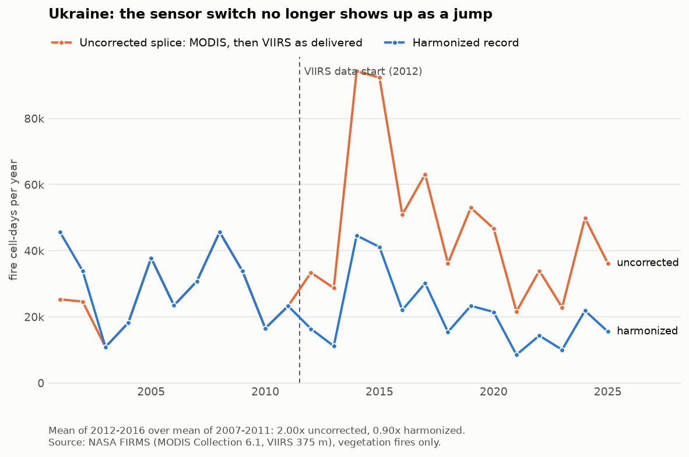

# Validation

Generated by `pipeline.validate` on 2026-11-14T10:37:46Z. Do not edit by hand: run `make validate`.

Unit: MODIS-equivalent fire cell-days. Error metric: WAPE = sum|prediction - truth| / sum(truth), on years the model did not see.
Weights are fitted on 2012-02-01 .. 2021-12-31.

## Argentina

Too little MODIS/VIIRS overlap downloaded for this country: calibration borrowed, not validated here.

## Ukraine

| Check | Bias | Country x year | Country x month | 1-degree tile x year | 1-degree tile x month |
|---|---|---|---|---|---|
| Harmonized VIIRS vs MODIS, each year predicted without seeing it | -0.1% | 4.3% | 8.0% | 11.5% | 20.7% |
| Baseline: one scaling factor for the whole country | +0.0% | 4.9% | 13.8% | 14.6% | 25.9% |
| Baseline: VIIRS cell-days as delivered | +122.3% | 122.3% | 122.3% | 122.3% | 123.0% |
| NOAA-20 vs MODIS (NOAA-20 was not used to fit the weights) | +2.2% | 2.2% | 6.3% | 10.7% | 21.4% |
| Terra-only months scaled to Terra + Aqua, leave-one-year-out | +0.6% | 2.9% | 6.2% | 8.3% | 16.5% |

Seam check, mean yearly total 2012-2016 over 2007-2011:
uncorrected splice 2.00x, harmonized 0.90x.

Detection curve: share of VIIRS fire cell-days that MODIS also reported nearby the same day.

| Fire power of the cell-day (MW) | Night only | With a daytime detection |
|---|---|---|
| 0 - 1 | 7% | 12% |
| 1 - 2 | 11% | 12% |
| 2 - 4 | 17% | 19% |
| 4 - 8 | 27% | 31% |
| 8 - 16 | 39% | 43% |
| 16 - 32 | 53% | 54% |
| 32 - 64 | 60% | 63% |
| 64 - more | 67% | 67% |

Scale k = 1.4607. NOAA-20 to S-NPP factor = 0.9943.
Months left out of that factor as sensor gaps: 2020-05, 2022-07, 2022-08, 2024-07, 2024-11.

MODIS against the VIIRS-equivalent of the same year (1.0 = the sensors agree; Terra alone in brackets):

2012: 1.10 (0.46), 2013: 0.94 (0.44), 2014: 1.00 (0.44), 2015: 0.98 (0.46), 2016: 0.98 (0.52), 2017: 1.09 (0.55), 2018: 0.95 (0.43), 2019: 0.97 (0.45), 2020: 1.01 (0.48), 2021: 0.91 (0.44), 2022: 0.88 (0.41), 2023: 1.00 (0.43), 2024: 0.92 (0.38), 2025: 0.93 (0.31)
