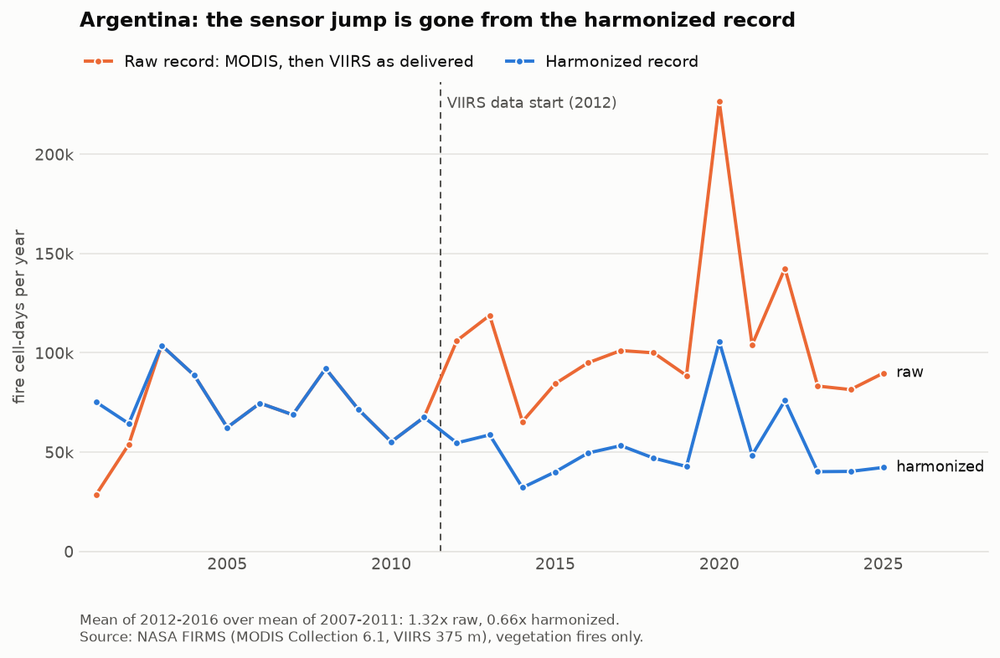

# Validation

Generated by `pipeline.validate` on 2026-11-15T15:19:44Z. Do not edit by hand: run `make validate`.

Unit: MODIS-equivalent fire cell-days. Error metric: WAPE = sum|prediction - truth| / sum(truth), on years the model did not see.
Weights are fitted on 2012-02-01 .. 2021-12-31.

## Argentina

| Check | Bias | Country x year | Country x month | 1-degree tile x year | 1-degree tile x month |
|---|---|---|---|---|---|
| Harmonized VIIRS vs MODIS, each year predicted without seeing it | +0.8% | 4.8% | 6.6% | 13.9% | 22.8% |
| The same with sensor gap days counted against the method | +0.4% | 4.8% | 6.8% | 13.9% | 22.9% |
| The same with the plain table by fire power instead of the chosen method | +0.6% | 5.4% | 7.3% | 15.7% | 24.7% |
| Baseline: one scaling factor for the whole country | +0.0% | 3.5% | 9.7% | 21.3% | 30.7% |
| Baseline: VIIRS cell-days as delivered | +106.7% | 106.7% | 106.7% | 107.3% | 110.4% |
| NOAA-20 vs MODIS (NOAA-20 was not used to fit the weights) | +3.5% | 4.3% | 5.0% | 13.7% | 21.6% |
| Terra-only months scaled to Terra + Aqua, leave-one-year-out | +0.0% | 3.2% | 7.3% | 18.2% | 29.3% |

Sensor jump check, mean yearly total 2012-2016 over 2007-2011:
raw record 1.32x, harmonized 0.66x.

Detection curve: share of VIIRS fire cell-days that MODIS also reported nearby the same day.

| Fire power of the cell-day (MW) | Night only | With a daytime detection |
|---|---|---|
| 0 - 1 | 10% | 2% |
| 1 - 2 | 20% | 10% |
| 2 - 4 | 32% | 17% |
| 4 - 8 | 46% | 30% |
| 8 - 16 | 62% | 44% |
| 16 - 32 | 75% | 59% |
| 32 - 64 | 83% | 71% |
| 64 - more | 90% | 83% |

Method: the mean of the table by fire power and the context model. Chosen on years held out three at a time, country x month error: table by fire power 7.0%, boosted weight 7.6%, context model 6.5%, mean of the table by fire power and the context model 6.2%, mean of the boosted weight and the context model 6.5%. Anything but the table is used only when it wins by more than 0.2 points. In the leave-one-year-out check above the choice is made again for every year from the other years alone: the mean of the table by fire power and the context model for 2012, 2013, 2014, 2016, 2019, 2020, 2021; the context model for 2015, 2017, 2018.
Scale k = 1.2243. NOAA-20 to S-NPP factor = 1.0.
Months left out of that factor as sensor gaps: 2022-07, 2024-07.

Sensor gap days (the sensor reported under 0.6 fire cell-days per MODIS one while MODIS had at least 100, or under 0.1 per cell-day of the other VIIRS sensor while that one had at least 50):
- viirs_snpp: 2014-02-04, 2014-08-08, 2015-01-18, 2016-01-11, 2016-08-13, 2016-12-30, 2018-01-29, 2021-08-03, 2022-06-28, 2022-07-26, 2022-07-27, 2022-07-28, 2022-07-29, 2022-07-30, 2022-07-31, 2022-08-01, 2022-08-02, 2022-08-03, 2022-08-04, 2022-08-05, 2022-08-06, 2022-08-07, 2022-08-08, 2022-08-09, 2022-08-10, 2023-07-26, 2023-07-27, 2024-05-30, 2024-05-31, 2024-06-01, 2024-06-02, 2024-06-03, 2024-07-10, 2024-07-11, 2024-07-12, 2024-07-13, 2024-07-14, 2024-07-15, 2024-07-24, 2024-07-25, 2024-07-26, 2024-07-27, 2024-07-28, 2024-09-26, 2024-09-27, 2024-11-04, 2024-11-05, 2025-07-04, 2025-07-07
- viirs_noaa20: 2023-07-19, 2023-07-20, 2023-07-21, 2023-07-22, 2023-09-30, 2024-02-04, 2024-02-05

MODIS against the VIIRS-equivalent of the same year (1.0 = the sensors agree; Terra alone in brackets):

2012: 1.04 (0.38), 2013: 1.00 (0.38), 2014: 1.04 (0.42), 2015: 1.04 (0.38), 2016: 1.07 (0.39), 2017: 1.05 (0.40), 2018: 0.98 (0.35), 2019: 1.04 (0.37), 2020: 0.92 (0.33), 2021: 0.98 (0.36), 2022: 0.86 (0.31), 2023: 1.02 (0.40), 2024: 1.05 (0.34), 2025: 0.98 (0.29)

## Ukraine

| Check | Bias | Country x year | Country x month | 1-degree tile x year | 1-degree tile x month |
|---|---|---|---|---|---|
| Harmonized VIIRS vs MODIS, each year predicted without seeing it | -0.4% | 2.7% | 5.8% | 10.1% | 18.9% |
| The same with sensor gap days counted against the method | -1.2% | 3.3% | 6.4% | 10.6% | 19.3% |
| The same with the plain table by fire power instead of the chosen method | -0.2% | 3.4% | 6.5% | 10.6% | 19.6% |
| Baseline: one scaling factor for the whole country | +0.0% | 4.3% | 13.2% | 14.2% | 25.5% |
| Baseline: VIIRS cell-days as delivered | +123.9% | 123.9% | 123.9% | 123.9% | 124.4% |
| NOAA-20 vs MODIS (NOAA-20 was not used to fit the weights) | -0.5% | 1.4% | 5.6% | 9.6% | 19.8% |
| Terra-only months scaled to Terra + Aqua, leave-one-year-out | +0.6% | 2.9% | 6.2% | 8.3% | 16.5% |

Sensor jump check, mean yearly total 2012-2016 over 2007-2011:
raw record 2.00x, harmonized 0.90x.

Detection curve: share of VIIRS fire cell-days that MODIS also reported nearby the same day.

| Fire power of the cell-day (MW) | Night only | With a daytime detection |
|---|---|---|
| 0 - 1 | 7% | 12% |
| 1 - 2 | 11% | 12% |
| 2 - 4 | 17% | 19% |
| 4 - 8 | 27% | 31% |
| 8 - 16 | 39% | 43% |
| 16 - 32 | 53% | 54% |
| 32 - 64 | 60% | 63% |
| 64 - more | 67% | 67% |

Method: the context model. Chosen on years held out three at a time, country x month error: table by fire power 7.1%, boosted weight 6.6%, context model 6.0%, mean of the table by fire power and the context model 6.3%, mean of the boosted weight and the context model 6.1%. Anything but the table is used only when it wins by more than 0.2 points. In the leave-one-year-out check above the choice is made again for every year from the other years alone: the context model for 2012, 2018, 2019, 2021; the mean of the boosted weight and the context model for 2013, 2014, 2015, 2016, 2017, 2020.
Scale k = 1.4501. NOAA-20 to S-NPP factor = 0.995.
Months left out of that factor as sensor gaps: 2020-05, 2022-07, 2022-08, 2024-07, 2024-11.

Sensor gap days (the sensor reported under 0.6 fire cell-days per MODIS one while MODIS had at least 100, or under 0.1 per cell-day of the other VIIRS sensor while that one had at least 50):
- viirs_snpp: 2012-03-24, 2012-03-25, 2012-03-26, 2021-08-04, 2022-07-27, 2022-07-28, 2022-07-29, 2022-07-30, 2022-07-31, 2022-08-01, 2022-08-02, 2022-08-03, 2022-08-04, 2022-08-05, 2022-08-06, 2022-08-07, 2022-08-08, 2022-08-09, 2022-08-10, 2023-07-26, 2023-07-27, 2024-06-01, 2024-06-02, 2024-06-03, 2024-07-10, 2024-07-11, 2024-07-12, 2024-07-13, 2024-07-14, 2024-07-15, 2024-07-16, 2024-07-25, 2024-07-26, 2024-07-27, 2024-07-28, 2024-07-29, 2024-09-27, 2025-07-06, 2025-07-07
- viirs_noaa20: 2023-07-19, 2023-07-20, 2023-07-21, 2023-07-22, 2023-09-30, 2023-10-01

MODIS against the VIIRS-equivalent of the same year (1.0 = the sensors agree; Terra alone in brackets):

2012: 1.10 (0.46), 2013: 0.96 (0.45), 2014: 1.02 (0.45), 2015: 0.99 (0.46), 2016: 0.98 (0.53), 2017: 1.08 (0.55), 2018: 0.95 (0.42), 2019: 0.97 (0.45), 2020: 1.01 (0.48), 2021: 0.92 (0.44), 2022: 0.88 (0.40), 2023: 0.99 (0.42), 2024: 0.92 (0.38), 2025: 0.95 (0.32)
